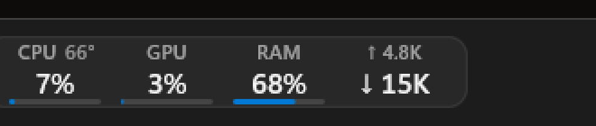

# Taskbar Pulse

**CPU, GPU, memory, network and CPU temperature, inside your Windows taskbar.**

One 290 KB executable. No installer, no runtime, no telemetry.



A small native Windows widget that sits in the taskbar next to the notification area. It shows what the machine is doing without a floating window, a Store app or a second panel taking up screen space. There is nothing to install: copy the exe, run it.

## At a glance

| | |
| --- | --- |
| Executable | **290 KB**, one file |
| Private memory | about **9 MB** |
| CPU use | **about 0.4%** of one core at a 1 s refresh |
| Installer / runtime / admin | **none** |
| Network connections | **none** — it reads local counters |

## Features

- **CPU, GPU and RAM** with fixed-width columns and tabular figures, so the numbers do not dance.
- **Download and upload** in bytes per second, from the interface Windows actually routes through.
- **CPU temperature** from the ACPI thermal zone, with no driver.
- **Per-metric alerts** — each percentage metric has its own warn and critical level; only the one that crosses turns amber or red, and only after holding for 1.5 seconds.
- **Multi-GPU laptops** — automatic (busiest adapter) or pinned to one GPU.
- **Taskbar-native** — drag it anywhere along the bar, lock it in place, or switch to borderless for a bare readout.
- **Follows Windows** — light and dark theme, DPI changes, Explorer restarts, virtual desktops.
- **Keyboard settings** — Tab, Space/Enter, arrows and Esc; no mouse required.
- **Quiet** — no telemetry, no network access, no service, no background updates.

## Benchmarks

Measured on a laptop running Windows 11 26H2 at 1920×1200 and 125% scaling, one minute after launch, with temperatures and network enabled. Private working set comes from `\Process(...)\Working Set - Private`; CPU time was sampled over 20 to 30 seconds.

| | Taskbar Pulse | TrafficMonitor 1.86 Lite |
| --- | --- | --- |
| Download | **0.28 MB, one exe** | 1.02 MB zip, 1.92 MB exe, 3.17 MB folder |
| Private working set | **about 9 MB** | 12.0 MB |
| CPU at one update per second | **about 0.4% of one core** | 0.63% |
| Installer / runtime | none | none (Lite) |
| GPU load | yes | yes (Lite 1.86+) |
| Network speed | yes | yes |
| CPU temperature | yes, no admin | plugin, needs admin |
| Per-metric alerts | yes | no |
| Multi-GPU pinning | yes | no |

The resource numbers were measured here. The rest of the table is a feature comparison. TrafficMonitor's temperature support has moved to a separate Hardware Monitor plugin, and that plugin needs administrator rights; the Lite build alone does not include temperatures.

## Why this instead of the usual options

- **It is part of the taskbar.** Not a floating window, not a Store app, not a full Task Manager window. It uses the strip in front of the notification area and stays out of the way.
- **The download is one file.** 290 KB, no installer, no runtime, no admin rights, no update service. Copy it, run it, delete it.
- **It costs less than the alternatives.** About 9 MB and 0.4% of one core, measured above.
- **Alerts that mean something.** Each metric has its own threshold, and only the metric that crossed changes colour. No whole-widget flashing.
- **Network speed that does not lie.** It reads one routed interface with 64-bit counters instead of summing filter drivers and virtual adapters — the usual way these numbers get inflated.
- **Nothing to trust.** No telemetry, no network connections, no service, no hidden background work.

## When another tool is better

- **History graphs, per-core detail or per-process network:** Task Manager or TrafficMonitor.
- **Skins and a floating window:** TrafficMonitor.
- **RAM temperature:** Windows does not expose it to user-mode software; tools that show it install a kernel driver.
- **Disk activity, fan control, overclocking:** a different class of tool entirely.

## Install

Download `TaskbarPulse.exe` from the [latest release](../../releases/latest) and run it. That is the whole install.

- On first launch it adds itself to the current user's Run key; turn **Start with Windows** off in Settings to remove it.
- Settings live in `%APPDATA%\TaskbarPulse\settings.ini`.
- SmartScreen may warn about an unsigned exe from a new project. Choose **More info → Run anyway**, or build it yourself (below).

## Using it

Right-click the widget for its menu. Drag it anywhere along the taskbar; position lock stops accidental drags.


Settings is a separate window and applies changes live.


Keyboard: Tab moves between controls, Space or Enter activates the focused one, Left and Right adjust a stepper or move through a segmented row, Esc closes. With the tray icon focused (Win+B, then arrow keys), Enter opens Settings.

### Alerts

Each percentage metric has its own warn and critical level, adjustable in 5% steps; the default is 70 and 90. Pick CPU, GPU or RAM in Settings, then adjust its two numbers. A metric must stay above its level for 1.5 seconds before it turns, and clears 2 points below the level, so a one-second spike or a value sitting on the line does not trigger it. Only that metric's number and bar change colour.

### Temperature

CPU temperature comes from the ACPI thermal zone and is read once per sample when switched on. It is a zone reading, not a core sensor, so it tracks the package on some laptops and a nearby board sensor on others. It is off by default.

GPU temperature is not shown: reading it would mean loading a vendor runtime or shipping a kernel driver. RAM temperature is not exposed to user-mode software at all, which is why tools that display it install a kernel driver to read the SMBus/SPD hub or the embedded controller.

### Network

The NET column shows upload on the label line and download on the value line, in bytes per second, averaged over the sample interval. It follows the interface Windows routes internet traffic through, re-checked every five seconds, so Wi-Fi, Ethernet and VPN switches are followed. If both Ethernet and Wi-Fi are connected, Windows normally prefers Ethernet and that is what you see; the two are never summed.

The counters are the same interface counters Task Manager graphs, so they include packet headers and retransmissions. Measured against a 20 MiB upload, the interface counted 21,233,168 bytes: 1.25% over the payload. Checked against an independent read of the same counters, 12 to 20 second transfers agreed within 2.5%.

With a full-tunnel VPN the default route moves to the tunnel, so the meter follows it and reports the traffic entering the tunnel — the payload your apps see. With split tunnelling it stays on the physical NIC. A DNS resolver alone changes nothing.

### The Start menu

While Start or Search is open, Windows lifts the taskbar above every top-level window, including always-on-top ones, so the widget is covered until the menu closes. No portable app can draw above it; a plain always-on-top window is covered the same way. The widget is back within a frame of the menu closing.

## Compatibility

Windows 11 22H2 through 26H2 on x64. Windows 10 1809 and later should work, since every API it uses exists there, but it has not been tested. Windows 8.1 and older will not work. There is no ARM64 build.

CPU figures are vendor-neutral. GPU usage comes from the WDDM `GPU Engine` counters, so Intel, Intel Arc, AMD and NVIDIA adapters all use the same path, and the GPU list comes from DXGI. On machines where the driver does not expose those counters — some virtual machines and RDP sessions — the GPU column shows `—`.

The widget is a topmost layered window over the taskbar. Windows 11 removed taskbar deskbands, so an overlay is the only supported route.

## Known limitations

- If you open enough windows, the centred taskbar buttons can grow under the widget. Drag it elsewhere, hide a metric or lock it in place.
- Only the primary taskbar is supported.
- The NET column follows the default-route interface only; a second NIC or a host-only VM network is not added in.
- If a VPN's virtual adapter publishes no NDIS counters, the NET column shows `—` rather than a number.

## Build from source

Visual Studio with the C++ toolset and the Windows 11 SDK.

```powershell
.\build.ps1
```

The output is `TaskbarPulse.exe` next to the script. It links the static CRT, so the exe has no runtime dependency.

<details>
<summary>How it works</summary>

DirectWrite draws into a 32 bpp DIB and `UpdateLayeredWindow` pushes it with per-pixel alpha. The renderer is Direct2D in software mode, which avoids pulling the graphics driver into the process. Metrics are sampled on a worker thread: `GetSystemTimes` for CPU, `GlobalMemoryStatusEx` for memory, the PDH `GPU Engine` counters for load, the ACPI thermal zone for temperature, and `GetBestRoute2` plus `GetIfEntry2` for network. The GPU figure follows Task Manager: sum each engine across processes, cap every engine at 100%, and report the busiest engine. The menu and settings window are drawn by the app, so they keep the same look and do not depend on native control theming.

`DESIGN.md` describes the visual direction.

</details>

## License

MIT. See [LICENSE](LICENSE).
