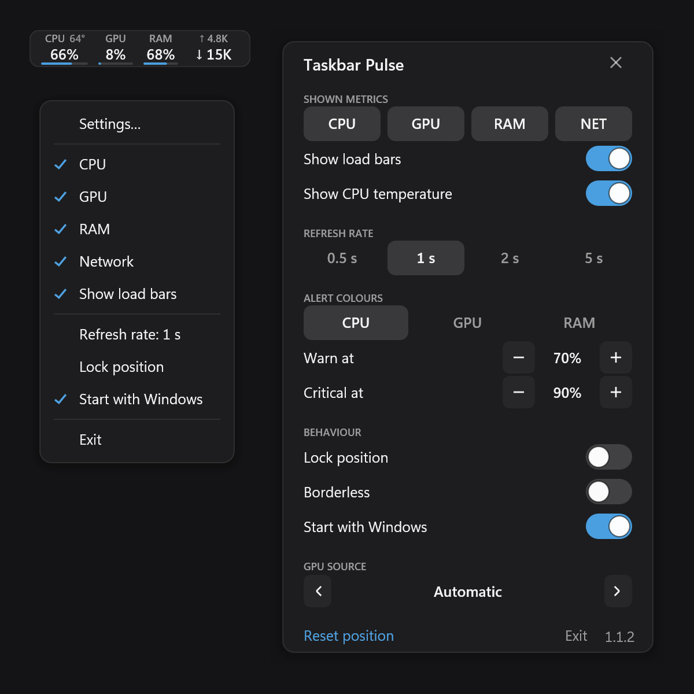
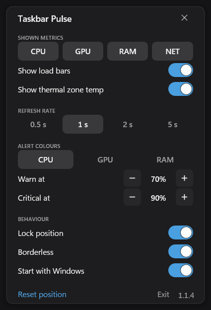

<h1 align="center">Taskbar Pulse</h1>

<p align="center">
  <b>CPU, GPU, memory, network and temperature, in your taskbar.</b><br>
  A 300 KB native widget. No installer, no runtime, no telemetry.
</p>

<p align="center">
  <a href="../../actions/workflows/build.yml"></a>
  <a href="../../releases/latest"></a>
  
  
  
</p>

<p align="center">
  <a href="../../releases/latest">Download</a> ·
  <a href="#features">Features</a> ·
  <a href="#benchmarks">Benchmarks</a> ·
  <a href="#build">Build</a> ·
  <a href="CHANGELOG.md">Changelog</a>
</p>



## What is this?

A taskbar widget for Windows 11 that shows CPU, GPU, memory, network throughput and CPU temperature in one small strip. It is a native **C++20** app built on the Win32 API, Direct2D and DirectWrite — no Electron, no .NET, no runtime.

It was **vibecoded**: written with an AI assistant from a written spec, then reviewed, benchmarked and tested by hand. The numbers below are measurements from the running build.

## Features

- **CPU, GPU, RAM** — live, with fixed columns so the numbers never dance.
- **Download and upload** — bytes per second, measured from the interface Windows actually routes through.
- **CPU temperature** — straight from ACPI, no driver.
- **Alerts that mean something** — each metric has its own warn and critical level; only the one that crosses changes colour.
- **Taskbar-native** — drag it anywhere, lock it, go borderless. Follows light/dark, DPI, Explorer restarts and virtual desktops.
- **Readable on every accent** — check marks, switches and the reset link are contrast-checked against the surfaces they sit on, so yellow, white or black accents stay legible in both themes.
- **Keyboard settings** — Tab, Space/Enter, arrows, Esc.
- **Nothing behind it** — no telemetry, no network calls, no service, no updates.

## Benchmarks

Measured on a laptop with Windows 11 26H2 at 1920×1200 and 125% scaling, one minute after launch. Memory is the private working set; CPU time was sampled over 20–30 seconds.

| | Taskbar Pulse | TrafficMonitor 1.86 Lite |
| --- | --- | --- |
| Download | **300 KB, one exe** | 1.92 MB exe |
| Private memory | **about 9 MB** | 12.0 MB |
| CPU at 1 s | **about 0.4% of one core** | 0.63% |
| CPU temperature | yes, no admin | plugin, needs admin |
| Per-metric alerts | yes | no |
| Multi-GPU pinning | yes | no |

## Why Taskbar Pulse

- **It lives in the taskbar.** Not a floating window, not a Store app, not another Task Manager. It uses the strip in front of the notification area and stays out of the way.
- **It is one file.** 300 KB, no installer, no runtime, no admin rights. Copy it, run it, delete it.
- **It is measured, not claimed.** ~9 MB of RAM and ~0.4% of one core, with the numbers above.
- **Its network meter does not inflate.** One routed interface, 64-bit counters, no summed filter drivers or virtual adapters.
- **Nothing to trust.** No telemetry, no network connections, no background service.

## Install

Download `TaskbarPulse.exe` from the [latest release](../../releases/latest) and run it. There is no installer.

On first launch it adds itself to the current user's Run key; turn **Start with Windows** off in Settings to remove it. Settings live in `%APPDATA%\TaskbarPulse\settings.ini`.

Windows may warn that the publisher could not be verified, because the exe is unsigned. The release notes list its SHA-256; compare it with `Get-FileHash .\TaskbarPulse.exe -Algorithm SHA256`. If Windows shows the "Open File" prompt, choose **More info → Run anyway**, or clear the download flag first with `Unblock-File .\TaskbarPulse.exe`.

## Usage

Right-click the widget for the menu; drag it along the taskbar, lock it in place, or make it borderless.


The settings window applies changes live:



Each percentage metric has its own warn and critical level, adjustable in 5% steps. A metric must hold above its level for 1.5 seconds before it turns, and clears 2 points below it, so a spike or a value sitting on the line does not flicker. Only that metric's number and bar change colour.

CPU temperature is a thermal-zone reading and is off by default. The network column follows the default-route interface, so it shows the adapter you are actually using; Wi-Fi and Ethernet are never added together.

Tab moves between controls, Space or Enter activates one, Left and Right adjust a value, and Esc closes. With the tray icon focused (Win+B, arrow keys), Enter opens Settings.

## Compatibility

Windows 11 22H2 through 26H2 on x64. Windows 10 1809 and later should work, since every API it uses exists there, but it has not been tested. No ARM64 build.

GPU usage comes from the WDDM counters, so Intel, Intel Arc, AMD and NVIDIA adapters all work. Where the driver does not expose those counters — some VMs and RDP sessions — the GPU column shows `—`.

## Known limitations

- Only the primary taskbar is supported.
- While Start or Search is open, Windows lifts the taskbar above every top-level window, so the widget is covered until the menu closes. No portable app can draw above it.
- The network column follows the default-route interface only; a second NIC or a host-only VM network is not added in.

## Build

Visual Studio with the C++ toolset and the Windows 11 SDK.

```powershell
.\build.ps1
```

The output is `TaskbarPulse.exe` next to the script, linked against the static CRT so it has no runtime dependency. The script also runs the contrast regression test, so a change that drops accent text below 4.5:1 or an accent fill below 3:1 fails the build.

Every push also builds the exe in GitHub Actions. Fork the repo, edit it, and download `TaskbarPulse-windows-x64` from the run's **Artifacts**; push a tag like `v1.0.0` and the workflow publishes it as a release.

## License

MIT — use it, fork it, ship it, keep the copyright notice. See [LICENSE](LICENSE).
