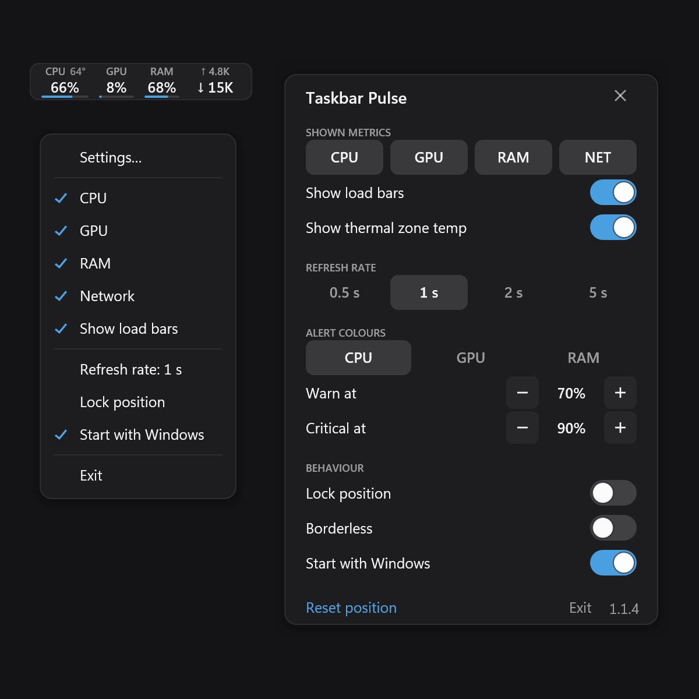
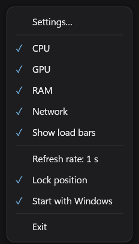

<h1 align="center">Taskbar Pulse</h1>

<p align="center">
  <b>CPU, GPU, memory, network and temperature, in your taskbar.</b><br>
  A 300 KB native widget. No installer, no runtime, no telemetry.
</p>

<p align="center">
  <a href="../../actions/workflows/build.yml"></a>
  <a href="../../releases/latest"></a>
  
  
  
</p>

<p align="center">
  <a href="../../releases/latest">Download</a> ·
  <a href="#features">Features</a> ·
  <a href="#screenshots">Screenshots</a> ·
  <a href="#benchmarks">Benchmarks</a> ·
  <a href="#build">Build</a> ·
  <a href="CHANGELOG.md">Changelog</a>
</p>

<p align="center">
  <a href="docs/taskbarpulse_ui.png"></a>
</p>

## What is this?

A native Windows 11 taskbar widget for CPU, GPU, memory, network and the ACPI thermal zone. It is one C++20 exe built on Win32 and Direct2D, with no installer, runtime, admin rights or telemetry.

Built with AI assistance, then reviewed, tested and benchmarked by hand.

## Features

- CPU, GPU, RAM and the ACPI thermal zone, with fixed columns.
- Network up and down from the interface Windows actually routes through.
- Per-metric warning and critical colours.
- Multi-GPU support: automatic or pinned to one adapter.
- Taskbar-native: drag, lock, borderless; follows light/dark, DPI, Explorer restarts and virtual desktops.
- Readable on any accent, with contrast-checked check marks and switches.
- Keyboard settings with Tab, arrows, Space and Esc.

## Screenshots

| Menu | Settings |
| --- | --- |
|  |  |

## Benchmarks

Measured on a laptop with Windows 11 26H2 at 1920×1200 and 125% scaling, one minute after launch.

| | Taskbar Pulse | TrafficMonitor Lite 1.86 |
| --- | --- | --- |
| Download | **300 KB, one exe** | 1.92 MB exe |
| Private memory | **about 9 MB** | 12.0 MB |
| CPU at 1 s | **about 0.4% of one core** | 0.63% |
| Temperature | **ACPI thermal zone** | none |

## Install

Download `TaskbarPulse.exe` from the [latest release](../../releases/latest) and run it. There is no installer.

It adds itself to the current user's Run key. Turn **Start with Windows** off in Settings to remove it. Settings live in `%APPDATA%\TaskbarPulse\settings.ini`.

Windows may warn that the publisher is unknown because the exe is unsigned. The release notes list the SHA-256. Choose **More info > Run anyway**, or run `Unblock-File .\TaskbarPulse.exe` first.

## Usage

Right-click the widget for the menu. Drag it along the taskbar, lock it, or make it borderless.

Settings apply live. Tab moves between controls, arrows change a value, Space or Enter activates one, and Esc closes.

## Compatibility

Windows 11 22H2 to 26H2 on x64. Windows 10 1809 and later should work but is untested. No ARM64 build.

GPU usage comes from the WDDM counters. Some VMs and RDP sessions do not expose them and show a dash.

## Known limitations

- Only the primary taskbar is supported.
- While Start or Search is open, Windows puts the taskbar above every window, so the widget is covered.
- The temperature is the warmest ACPI thermal zone, not a core sensor. Accuracy and update rate vary by OEM. Verified on an Acer Predator PHN16-72, which exposed one zone (`\_TZ.TZ00`); an offset against HWiNFO or Core Temp was not measured.
- The network column follows the default-route interface only; a second NIC or a host-only VM network is not added in.

## Build

Visual Studio with the C++ toolset and the Windows 11 SDK.

```powershell
.\build.ps1
```

The output is `TaskbarPulse.exe`, statically linked. The script also runs the contrast regression test. Every push builds in GitHub Actions, and a `v*` tag publishes a release with the exe and SHA-256.

## License

MIT. Use it, fork it, ship it, keep the copyright notice. See [LICENSE](LICENSE).
